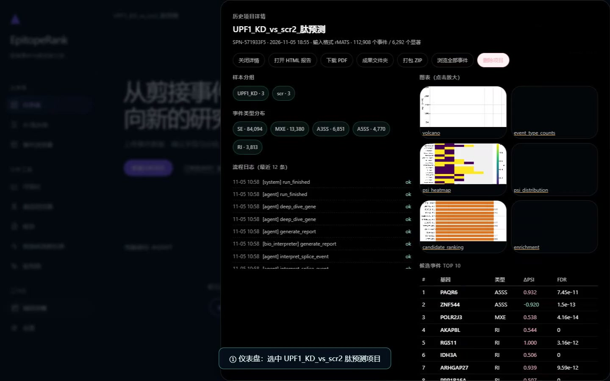

# EpitopeRank

**AI-driven alternative splicing analysis and splice-derived neoantigen ranking**

[](https://github.com/Zhouhao-stak/EpitopeRank/actions/workflows/test.yml)
[](https://github.com/Zhouhao-stak/EpitopeRank/releases)
[](https://www.python.org/downloads/)
[](LICENSE)

**简体中文** ｜ English

Drop in a set of rMATS results and get back a splicing report you can actually
read, reproduce and cite. When you need to go one step further, turn the same
events into HLA-presented candidate neoantigen peptides.

```
rMATS JC tables (5 event types) + sample metadata
        ↓
multi-agent analysis (profile → statistics → ranking → enrichment → literature → report)
        ↓
figures + candidate genes + pathway enrichment + HTML/PDF report
        ↓
splice junction peptides (8–11mer) → HLA binding prediction → ranked neoantigens
```

**Out of scope**: FASTQ QC, alignment (STAR/HISAT2), transcript assembly. The
input is already-quantified splicing output, not raw sequencing data.

> 📖 Complete Chinese manual: [docs/USER_GUIDE.md](docs/USER_GUIDE.md) ·
> illustrated walkthrough: [docs/手把手教程.html](docs/手把手教程.html)

---

## Download and run

Grab the latest `EpitopeRank-*-windows.zip` from
[Releases](https://github.com/Zhouhao-stak/EpitopeRank/releases), unzip and
double-click `EpitopeRank-Desktop.exe`.

The current release adds **model-call trace recording and strict offline replay** (`record -> replay -> compare`), MHC-II 11-30 aa peptide prediction and dark-theme result-table readability fixes. See the Chinese README for the full replay workflow.

The app starts a local service and opens your browser (typically
`http://127.0.0.1:8800/`). No Python required, no network required — the network
is only used for LLM interpretation and HLA prediction.

Optional `.env` next to the executable:

```ini
MODEL_API_BASE_URL=https://api.deepseek.com
MODEL_API_KEY=sk-...
MODEL_NAME=deepseek-flash
```

Without a key everything still runs; the autonomous kernel makes the same
decisions using rules instead of a model.

## From source

```bash
python -m venv venv
venv\Scripts\activate            # Windows
source venv/bin/activate         # macOS / Linux
pip install -r requirements.txt

python serve_ui.py --port 8800                 # Web UI + API
python serve_ui.py --port 8800 --workers 8     # multi-process (server)
```

Command line:

```bash
python examples/make_demo_data.py examples/demo_rmats
python run.py analyze --input examples/demo_rmats --query "assess splicing changes"
python run.py followup --project-id SPN-XXXX --query "only SE events"
```

Docker:

```bash
docker compose up -d   # Web UI + API on :8800 (UI served at /)
```

## What an analysis does

1. **Profile** — size, FDR coverage, missing values, junction support, group balance.
2. **Decide** — if FDR<0.05 yields nothing, relax the thresholds according to the
   observed distribution and record *why* in the report Methods and the run log.
3. **Statistics** — chi-square with BH correction; ΔPSI computed as IncLevel2 − IncLevel1.
4. **Rank** — significance 0.4 + effect size 0.3 + biology 0.2 + literature 0.1.
5. **Challenge** — five pre-registered tests (ΔPSI shift, direction balance,
   event-type bias, depth confounding, gene recurrence). Rejected tests become
   warnings in the report's Limitations.
6. **Enrich and retrieve** — GO/KEGG enrichment, PubMed search, BM25 full-text passages.
7. **Report** — self-contained HTML plus PDF.

## Input data

rMATS only (SUPPA2 / MAJIQ / LeafCutter / precomputed ΔPSI tables are no longer accepted).

| Input | Notes |
|---|---|
| `*.MATS.JC.txt` × 5 (SE / A5SS / A3SS / MXE / RI) + `sample_metadata.tsv` | standard path |
| A single rMATS JC table | quick single-event-type run |
| Vendor per-sample rMATS export (e.g. BGI RNAref `.xls`) | remapped through "smart ingest" |
| `AS_event_master.tsv` | internal standard table, produced or supplied |

`sample_metadata.tsv` columns: `sample_id, group, condition, tissue, batch`.

Optional: `gene_annotation.tsv` (GO/KEGG), `differential_expression.tsv`.

## Candidate peptides

A four-column CDS table drives the junction-peptide step:

| Column | Meaning |
|---|---|
| `event_id` | rMATS event ID (e.g. `RI:4579`) |
| `reference_cds` | CDS of the normal transcript |
| `altered_cds` | CDS after the splicing change |
| `junction_nt` | junction position in the CDS (**an integer offset, not a sequence**) |

**Filenames and column names are free-form.** Detection is content-based:

- any filename works; if several candidates exist you pick one;
- unrecognised headers are profiled by cell shape (sequence ratio, numeric
  ratio, event-ID shape), and the reference/altered orientation is decided by
  replaying junction peptides;
- the guess is shown in a one-time "confirm what each column means" panel;
- rMATS event tables are recognised by marker columns and skipped silently
  instead of being reported as an incomplete CDS table.

HLA prediction (IEDB NetMHCpan 4.1 EL):

```
HLA-A*02:01,HLA-B*07:02
```

Submitted in batches of 100 peptides with retry and throttling, cached on disk,
up to 20000 peptide × allele pairs per run; truncation is recorded in the
manifest. Leave it empty to skip the network entirely.

> **Interpretation**: sort by `percentile_rank`; **<0.5% is a strong binder**,
> <2% is weak. Do not report a 1.2% hit as positive.

## Where results go

Every finished run is also exported to a standalone folder:

```
<results root>/results/<project name>_<SP id>/
├── report.html / report.pdf
├── figures/              # volcano / heatmap / ranking / enrichment (PNG 300dpi + SVG)
├── neoantigen_results/   # only when peptides were generated
└── 项目说明.txt           # sample / event / significant counts
```

About 4 MB per project. The project page offers **open folder** and **package ZIP**.

Runtime root: `%LOCALAPPDATA%\EpitopeRank` on Windows,
`~/.local/share/epitoperank` on Linux, `/data` in Docker. Override with
`EPITOPERANK_RUNTIME_ROOT`; the results root has its own
`EPITOPERANK_RESULTS_ROOT`.

## Architecture

```
Profile → Verify → Decide → Act → Trace
   ↑                                │
   └──── goal unmet → reflect / replan (budgeted) ────┘
```

| Component | File | Role |
|---|---|---|
| AgentState | `epitoperank/agent/state.py` | facts / issues / steps blackboard with decidable acceptance criteria |
| Profile | `epitoperank/agent/profile.py` | dataset profiling |
| Actions | `epitoperank/agent/actions.py` | action registry |
| DecisionEngine | `epitoperank/agent/decision.py` | rule chain first, model suggestion optional |
| Verifier | `epitoperank/agent/verify.py` | result health checks |
| Reflector | `epitoperank/agent/reflector.py` | issue → remedial action |
| AutonomousAgent | `epitoperank/agent/loop.py` | OODA loop with step/time/error budgets |
| EpisodicMemory | `epitoperank/agent/episodic.py` | cross-run experience |
| Session | `epitoperank/agent/session.py` | multi-turn follow-up |

Five pre-registered hypothesis tests run before interpretation: `dpsi_shift`
(Wilcoxon), `direction_balance` (binomial), `event_type_bias` (chi-square GOF),
`coverage_confound` (Spearman), `gene_recurrence` (permutation). A rejected test
is surfaced as a warning, not hidden.

The **Settings** page holds the model configuration (Base URL / model / API key,
written only to the local `.env`) and an MCP tool console: pick a server and tool,
pass JSON arguments, or describe what you want and let the model propose
`{server, tool, arguments}` — validation and execution stay local.

## Tests

```bash
pip install -r requirements-dev.txt
pytest tests/unit tests/integration -v
pytest --cov=epitoperank --cov-report=html
```

268 tests pass (unit + API/UI integration).
CI runs on Python 3.10/3.11/3.12 with Black, Flake8 and MyPy; pushing a `v*` tag
builds the Windows portable build and publishes a release.

## Licence

**AGPL-3.0**, see [LICENSE](LICENSE). Built on the multi-agent architecture of
[BioGAIP](https://github.com/zhangjy859/BioGAIP) (kept in `legacy/` under its
original licence). HLA predictions come from IEDB; observe their citation and
licence terms.

## Demo video

A ~62-second narration-free UI walkthrough recorded with the real UPF1 rMATS
dataset (112,908 splicing events), with on-screen step captions and real IEDB
prediction results:

[](media/videos/EpitopeRank-v1.3.0-UPF1-demo.mp4)

[Download the MP4 from the v1.3.0 release](https://github.com/Zhouhao-stak/EpitopeRank/releases/download/v1.3.0/EpitopeRank-v1.3.0-UPF1-demo.mp4)
