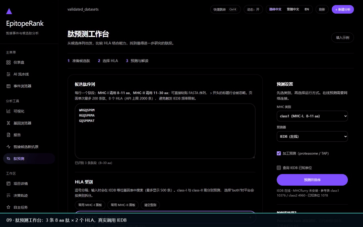

# EpitopeRank

**AI 驱动的可变剪接分析 + 剪接新抗原候选肽生成平台**

[](https://github.com/Zhouhao-stak/EpitopeRank/actions/workflows/test.yml)
[](https://github.com/Zhouhao-stak/EpitopeRank/releases)
[](https://www.python.org/downloads/)
[](LICENSE)

丢进一批 rMATS 结果，出来一份能读懂、能复现、能直接写进论文的剪接分析报告；
需要往下游走一步时，再把它变成 HLA 呈递的候选新抗原肽。

```
rMATS JC 五类事件表 + 样本元数据
        ↓
多智能体分析（画像 → 统计 → 排序 → 富集 → 文献 → 报告）
        ↓
可视化 + 候选基因 + 通路富集 + HTML/PDF 报告
        ↓
剪接连接肽（8–11mer）→ HLA 结合预测 → 候选新抗原排序
```

**不做**：FASTQ 质控、比对（STAR/HISAT2）、转录本组装。输入是「已量化的剪接结果」，
不是原始测序数据。

> 📖 **零基础用户** → [图文手把手教程](docs/手把手教程.html)（12 张真实界面截图 + 一套公开数据的实跑数字）
>
> 📚 **全部文档** → [docs/README.md](docs/README.md)

---

## 目录

- [下载即用](#下载即用)
- [演示视频](#演示视频)
- [从源码运行](#从源码运行)
- [一次完整分析长什么样](#一次完整分析长什么样)
- [输入数据](#输入数据)
- [生成候选肽](#生成候选肽)
- [结果在哪](#结果在哪)
- [架构](#架构)
- [项目结构](#项目结构)
- [测试与 CI](#测试与-ci)
- [文档索引](#文档索引)
- [致谢与许可](#致谢与许可)
- [模型轨迹录制与决策重放](#模型轨迹录制与决策重放)

## 下载即用

到 [Releases](https://github.com/Zhouhao-stak/EpitopeRank/releases) 下载最新的
`EpitopeRank-*-windows.zip`，解压后双击 `EpitopeRank-Desktop.exe`。

> 最新版新增：**模型调用轨迹录制与严格离线重放**（`record → replay → compare`）、MHC-II 11–30 aa 长肽预测、深色主题结果表格可读性修复。
> 详见文末 [模型轨迹录制与决策重放](#模型轨迹录制与决策重放)。

程序会在本机起一个服务并自动打开浏览器（地址形如 `http://127.0.0.1:8800/`），
**不需要装 Python，也不需要联网**——只有想用 AI 解读或跑 HLA 预测时才需要网络。

首次运行前，在同目录新建 `.env`（可参考压缩包里的 `.env.example`）：

```ini
# 可选：接入大模型做结果解读（不配也能跑，自治内核用规则决策）
MODEL_API_BASE_URL=https://api.deepseek.com
MODEL_API_KEY=sk-...
MODEL_NAME=deepseek-flash
```

## 演示视频

用 **UPF1 真实 rMATS 数据**（112,908 个剪接事件）录制的 **v1.4.2 全功能巡览**，
约 2 分 53 秒、无配音、带中文步骤字幕。所有交互都是真实调用，包括 IEDB
肽预测与分级判读、决策轨迹、自主任务的成功/失败状态与可复现证明：

[](https://github.com/Zhouhao-stak/EpitopeRank/releases/download/v1.4.2/EpitopeRank-v1.4.2-full-demo.mp4)

> 上方是视频中段（真实 IEDB 预测结果）的循环预览。GitHub 不内嵌 mp4 播放器，
> 因此用动图做首页预览；点它或下面的链接可在浏览器中直接播放完整视频。

- [在线播放完整视频（Release 资产，video/mp4）](https://github.com/Zhouhao-stak/EpitopeRank/releases/download/v1.4.2/EpitopeRank-v1.4.2-full-demo.mp4)
- [仓库内 MP4 副本](media/videos/EpitopeRank-v1.4.2-full-demo.mp4)
- [静态封面](media/posters/EpitopeRank-v1.4.2-full-demo.jpg)

覆盖顺序：仪表盘与项目详情抽屉 → 事件浏览器 → 可视化图表 → 基因详情 →
分析报告 → 剪接候选新抗原 → 肽预测工作台（真实 IEDB 结果、逐行强/弱/非结合
分级徽章与无可用候选提示）→ 决策轨迹（模型参与决策占比、来源徽章、完整性校验）
→ 自主任务（可审阅计划、成功与失败两种状态的醒目状态条、产物目录与打开报告、
计划/实际偏差、中文决策依据、可复现证明与一键离线重放验证）→ 工作区设置。

旧版两段中英双语录屏仍保留在 `master` 分支的 `media/videos/` 中。

## 从源码运行

```bash
# 1. 环境（Python >= 3.10）
python -m venv venv
venv\Scripts\activate            # Windows
source venv/bin/activate         # macOS / Linux
pip install -r requirements.txt

# 2. 起服务（两种入口任选）
python serve_ui.py --port 8800                 # Web 界面 + API
python serve_ui.py --port 8800 --workers 8     # 多进程（服务器上用）

# 3. 浏览器打开
# http://127.0.0.1:8800/
```

命令行也能跑：

```bash
# 造一份演示数据（合成 rMATS 输出：3 对照 + 3 肿瘤，47 个事件）
python examples/make_demo_data.py examples/demo_rmats

# 完整分析（无大模型 key 也能跑）
python run.py analyze --input examples/demo_rmats --query "分析RNA剪接变化"

# 在已有项目上追问，不重跑整条流水线
python run.py followup --project-id SPN-XXXX --query "只看 SE 事件"
```

> 需要复现一次带模型参与的分析？见文末 [模型轨迹录制与决策重放](#模型轨迹录制与决策重放)。

Docker：

```bash
docker compose up -d
# Web UI + API: http://localhost:8800（页面在 /）
```

Coolify 一键部署、无 root 服务器部署等方案见 [docs/deploy/](docs/deploy/)。

## 一次完整分析长什么样

1. **新建分析** — 填项目名、写一句分析意图（如「pDC 活化后可变剪接变化」），
   把 rMATS 五类表 + 元数据拖进去。
2. **自动画像与决策** — 平台先看数据（规模、FDR 覆盖率、组平衡、支持读数），
   再决定用哪套阈值。默认 FDR<0.05 筛不出东西时，会按数据分布放宽阈值重跑，
   并把「为什么改」写进报告 Methods 与流程日志；确实筛不出就如实写明局限。
3. **统计分析** — 卡方检验 + BH 校正，自算 ΔPSI（IncLevel2 − IncLevel1）。
4. **候选排序** — 显著性 0.4 + 效应量 0.3 + 生物学 0.2 + 文献 0.1。
5. **假设检验** — 5 个预注册检验（ΔPSI 偏移、方向平衡、事件类型偏倚、
   深度混杂、基因复现性），被拒绝的检验直接变成报告里的警告。
6. **富集与文献** — GO/KEGG 富集 + PubMed 检索 + 全文段落检索（BM25）。
7. **出报告** — HTML（图内嵌，可直接发人）+ PDF，覆盖 Summary / Methods /
   Results / Figures / Interpretation / Limitations / References。

## 输入数据

平台**只接受 rMATS 格式**（SUPPA2 / MAJIQ / LeafCutter / 预计算 ΔPSI 表已移除）。

| 输入 | 说明 |
|---|---|
| `*.MATS.JC.txt` × 5（SE / A5SS / A3SS / MXE / RI）+ `sample_metadata.tsv` | 标准用法，自动标准化为事件主表 |
| 单个 rMATS JC 表 | 单事件类型快速分析 |
| 厂商逐样本 rMATS 导出（如华大 RNAref `.xls`） | 经「智能接入」重映射为标准表 |
| `AS_event_master.tsv`（内部标准表） | 由上面前置生成，也可直接读 |

`sample_metadata.tsv` 列：`sample_id, group, condition, tissue, batch`。

> **v1.4.2 重要修正**：输入目录要指向**单个数据集文件夹**（目录里直接有
> `sample_metadata.tsv`），不要填多个数据集共用的上级目录。上级目录缺样本表时，
> 事件的有效样本数会被记为 0，质量闸门将挡掉所有显著事件，最终只产出一份空报告。
> 现在检测到这种目录会明确报错并推荐正确路径；只包一个数据集时会自动读取子目录样本表并给出提示。

可选附件：`gene_annotation.tsv`（GO/KEGG 列，用于富集）、
`differential_expression.tsv`（gene_id/log2FC/pvalue/padj/baseMean）。

格式细节见 [docs/USER_GUIDE.md](docs/USER_GUIDE.md)。

## 生成候选肽

这是「剪接 → 新抗原」那一步。核心是一个四列的 CDS 对照表：

| 列 | 含义 |
|---|---|
| `event_id` | 对应 rMATS 事件 ID（如 `RI:4579`） |
| `reference_cds` | 正常（参考）转录本的 CDS 序列 |
| `altered_cds` | 发生剪接改变后的 CDS 序列 |
| `junction_nt` | 新连接点在 CDS 中的位置（**整数边界，不是序列**） |

**表名和列名都可以随便起。** 平台按内容识别而不是按文件名：

- 文件名随意，`splice_orfs.tsv`、`客户给的剪接对照表.csv` 都行；目录里有多份时让你选。
- 表头不认识也能用——比如客户导出的是 `编号 / 位点 / 序列1 / 序列2`，
  平台会按单元格内容画像（序列占比、数字占比、事件 ID 形状）猜列角色，
  连「序列1 和序列2 哪个是参考」都会用 junction 肽回放来判方向。
- 猜完之后界面弹「**确认列的含义**」面板，四个下拉框已预填，核对一下点确认即可；
  同一项目只问一次。
- rMATS 的 `*.MATS.JC.txt` 不会被误当成残缺的编码序列表（按表头特征列识别后静默跳过）。

填 HLA 就跑免疫原性预测（IEDB NetMHCpan 4.1 EL）：

```
HLA-A*02:01,HLA-B*07:02
```

- 按每批 100 条提交 IEDB，自动重试与节流，结果落磁盘缓存；
- 单次最多 20000 个「肽 × 等位基因」组合，超了截断并在 manifest 里标注；
- 留空则只出肽、不联网。

**CDS 对照表不用再手工造**：新抗原页的「自动重建编码序列表」直接从项目里的 rMATS 事件坐标
重建 ORF，产出四列表 + 可审计 manifest（`epitoperank/splicing/orf_builder.py`）。
参考源可选 Ensembl REST（联网、缓存到运行根）或本地 GTF + FASTA（离线可复现）；
支持 SE / RI，其余事件类型记录跳过原因。坐标必须与参考基因组版本一致。

**结果自动分级**：预测完成后额外写出 `ranked_candidates.tsv`，按 `percentile_rank` 升序，
标注 `strong`（<0.5%）/ `weak`（<2%）/ `none`，并带基因、事件、ΔPSI、FDR 等元数据；
manifest 与界面状态栏同时给出分档计数。

**自主智能体与外网**：`agent.autonomous_planning` 让大模型在 OODA 每一步从完整动作表里选下一步，
规则链作为安全回退。内置 9 个 MCP 工具（`predict_mhc_binding`、`lookup_epitope`、
`peptide_properties`、`search_events` 等）已展开为**独立的一等动作**：模型能看到参数 schema、
传入结构化参数（如肽段列表），工具结果（percentile rank、命中数等）会回灌黑板供下一轮决策使用，
因此模型可以根据预测结果改变后续计划。所有工具调用连同结果快照写入 `agent_state.json`，重放时
使用快照、不访问外网。侧栏「决策轨迹」页展示每步的决策来源（规则 / 模型 / 反思 / 经验 / 重放）、
依据、模型原始响应与完整性校验。工具权限可用 `agent.allow_network` / `agent.allow_file_write` 关闭。
设置页可连接外部 MCP 服务器；`call_mcp_tool` 仍保留用于调用任意外部工具。

命令行：

```bash
python run.py peptide --input examples/peptide_demo \
  --cds examples/peptide_demo/splice_orfs.tsv \
  --alleles HLA-A*02:01 --mhc-class both --out out/peptide_run
```

> **判读口径**：按 `percentile_rank` 升序，**<0.5% 才是强结合**，<2% 属弱结合。
> 报结果前先看这两档，别拿 1.2% 当阳性。

方法细节见 [docs/PEPTIDE.md](docs/PEPTIDE.md) 与 [docs/NEOANTIGEN.md](docs/NEOANTIGEN.md)。

## 结果在哪

分析跑完，除了项目目录，还会**自动导出到独立的成果文件夹**：

```
<结果根>/results/<项目名>_<SP编号>/
├── report.html / report.pdf
├── figures/              # volcano / heatmap / ranking / enrichment（PNG 300dpi + SVG）
├── neoantigen_results/   # 生成过肽才有
└── 项目说明.txt           # 样本数 / 事件数 / 显著数
```

一个项目约 **4MB**。项目详情页有两个按钮：**📁 成果文件夹**（直接打开）和
**📦 打包 ZIP**（生成可发人的压缩包）。

**运行根目录**：Windows `%LOCALAPPDATA%\EpitopeRank`，Linux `~/.local/share/epitoperank`，
Docker 容器内 `/data`（命名卷 `epitoperank-data`），可用 `EPITOPERANK_RUNTIME_ROOT` 覆盖。
结果根可用 `EPITOPERANK_RESULTS_ROOT` 单独指定，默认在运行根下的 `results/`。

云端备份是可选的：服务器上部署后会暴露 `POST /api/cloud/upload`，
客户端在 `.env` 填 `EPITOPERANK_CLOUD_URL` 即可把成果 ZIP 推上去。

## 架构

### 自治内核（`epitoperank/agent/`，默认启用）

```
观察(Profile) → 校验(Verify) → 决策(Decide) → 执行(Act) → 记录(Trace)
       ↑                                                      │
       └────────── 目标未达成 → 反思重试 / 重规划（有预算） ─────┘
```

| 组件 | 文件 | 职责 |
|---|---|---|
| AgentState | `agent/state.py` | 事实/问题/步骤黑板 + 可判定的验收标准 |
| Profile | `agent/profile.py` | 数据画像：规模、FDR 覆盖率、缺失、支持读数、组平衡 |
| Actions | `agent/actions.py` | 33 个动作注册表：24 个原有动作 + 9 个一等化 MCP 工具 |
| DecisionEngine | `agent/decision.py` | 自我决策核心：模型规划优先于规则链，规则链作校验与安全回退 |
| Verifier | `agent/verify.py` | 结果体检，产出 Issue(code, severity, suggestion) |
| Reflector | `agent/reflector.py` | 问题 → 补救动作（改阈值 / 重试 / 降级接受） |
| AutonomousAgent | `agent/loop.py` | OODA 主循环 + 步数/时间/错误三重预算 + 决策轨迹 |
| EpisodicMemory | `agent/episodic.py` | 跨运行经验：相似数据上次用什么阈值成功过 |
| Session | `agent/session.py` | 多轮追问：状态快照 + 意图解析 + followup |
| McpActions | `agent/mcp_actions.py` | MCP 工具发现、参数 schema 校验、结果结构化回灌 |
| TraceView | `agent/trace_view.py` | 决策轨迹只读汇总：来源分布、完整性校验 |
| AnalysisPlan | `agent/plan.py` | 可审阅的计划契约、计划/实际偏差、可复现证明 |
| ModelTrace | `llm/trace.py` | 录制模型调用（prompt/响应/采样参数）与 MCP 工具快照，支持严格离线重放 |

决策**以规则为主、模型为辅**，所以离线（无 key）时同样是真决策，不是放录像。

### 自我质疑 + 外部知识

解读之前先跑 5 个预注册检验（纯本地 scipy，离线一致），BH 校正后写进报告：

| 检验 | H0 | 方法 |
|---|---|---|
| `dpsi_shift` | ΔPSI 分布未偏离 0 | Wilcoxon 符号秩 |
| `direction_balance` | 上调/下调事件均衡 | 二项检验 |
| `event_type_bias` | 显著事件类型构成 = 背景构成 | 卡方拟合优度 |
| `coverage_confound` | 效应量与测序深度无关 | Spearman 秩相关 |
| `gene_recurrence` | 命中不集中于少数基因 | 置换检验（1000 次） |

被拒绝的检验直接变成警告并进报告 Limitations——不遮掩对自己不利的结论。

### 设置页

左侧「⚙️ 设置」放两件事：

- **模型配置** —— 填 Base URL / 模型名 / API Key 即可启用报告里的 AI 解读，
  密钥只写本机 `.env`，不进报告、不进日志。
- **MCP 工具台** —— 手动选择服务器与工具并传 JSON 参数调用；也可以用一句自然语言
  让模型挑工具（模型只给 `{server, tool, arguments}` 建议，校验和执行都在本地）。

## 项目结构

```
EpitopeRank/
├── agent/             # 自治内核：状态/画像/决策/校验/反思/循环/经验记忆
│                      # + hypothesis.py / skills_bridge.py / interactive.py
├── agents/            # 3 个核心 Agent + 确定性策略（scripted 模式）
├── integrations/      # 可选后端：GSEApy(Enrichr) / MyGene，缺失自动降级
├── data/              # loader.py / validator.py（Standard BioAnalysis Format）
├── splicing/          # schema + parsers(rmats) + filtering + ranking
├── analysis/          # statistics / enrichment / visualization
├── knowledge/         # RAG（内置知识库 + PubMed + 全文 BM25 段落检索）
├── llm/               # 模型客户端 / 增强任务 / trace.py（轨迹录制与重放）
├── memory/            # SQLite Analysis Memory（项目/事件/候选/日志）
├── peptide/           # 肽预测：序列/理化/HLA/IEDB 客户端/novelty/评分/流水线
├── neoantigen*.py     # 剪接候选新抗原：junction 肽、分阶段流程、审计
├── results_export.py  # 成果文件夹导出 / 打包 ZIP / 云端上传
├── report/            # generator.py（HTML + PDF）
├── api/               # FastAPI
├── interface/         # Web UI（单文件内嵌）
├── config/            # config.yaml / agent_config.yaml / tool_config.yaml
├── tests/             # 单元 + 集成测试
├── examples/          # 演示数据生成器
├── packaging/         # PyInstaller spec
├── docs/              # 使用文档 / 教程 / 部署
└── legacy/            # BioGAIP 原始代码（归档保留）
```

## 测试与 CI

```bash
pip install -r requirements-dev.txt

pytest tests/unit tests/integration -v
pytest --cov=epitoperank --cov-report=html
```

当前 **377 个测试全部通过**（单元 + API/UI 集成，含轨迹录制、工具快照重放、计划契约与可复现证明回归）。

CI 在每次推送时跑：

- 单元测试（Python 3.10 / 3.11 / 3.12）
- 代码风格（Black、Flake8）
- 类型检查（MyPy）
- 覆盖率门槛（当前 20%，随覆盖率提升逐步收紧）

推送 `v*` tag 会自动构建 Windows 便携版并发布 Release（[.github/workflows/release.yml](.github/workflows/release.yml)）。

## 文档索引

| 文档 | 说明 |
|---|---|
| [手把手教程.html](docs/手把手教程.html) | **零基础图文教程**，12 张真实截图 |
| [USER_GUIDE.md](docs/USER_GUIDE.md) | **完整使用手册**：输入格式、生成肽三条路线、API 速查、FAQ |
| [QUICKSTART.md](docs/QUICKSTART.md) | 三步跑通第一个分析 |
| [NEOANTIGEN.md](docs/NEOANTIGEN.md) | 剪接新抗原流程与结果解读 |
| [PEPTIDE.md](docs/PEPTIDE.md) | 肽预测层：MHC-I/II、加工、稳定性、novelty、评分 |
| [DATASETS.md](docs/DATASETS.md) | 可用数据集与参考表来源 |
| [DATA_AND_DEPLOY.md](docs/DATA_AND_DEPLOY.md) | 数据存哪 · 部署 · 域名与 HTTPS |
| [智能体的手册.md](docs/智能体的手册.md) | 能力全清单与边界 |
| [函数与工具中文索引.md](docs/函数与工具中文索引.md) | 全仓函数/动作的中文说明与源码位置，便于维护交接 |
| [FONTS.md](docs/FONTS.md) | 字体来源、商用授权核实与打包裁剪说明 |
| [docs/README.md](docs/README.md) | 完整索引 |

## 设计原则

1. 复用 BioGAIP 成熟框架，不重建基础设施；
2. 增加剪接领域专用智能层（标准化、排序、证据）；
3. 无 LLM key 时全流程仍可运行（规则驱动的确定性决策）；
4. 可无缝接入 Phase 2（FASTQ → 比对 → 剪接检测 → 现有 AI 层）；
5. 全程可复现：workflow、参数、软件版本、日志全部留痕；模型调用与 MCP 工具结果快照写入 `agent_state.json`，可用 `run.py replay` 严格离线重放、`run.py compare` 逐项比对；数值计算始终由确定性工具完成，模型只决定调用哪些工具；
6. 结论必须有证据支撑，严格区分「已证实的统计结果」与「待验证的假设」。

## 路线图

- **Phase 2**：FASTQ 处理、比对 pipeline（rMATS 在线运行）
- **Phase 3**：单细胞 RNA-seq、多组学
- **Phase 4**：受控自主的科研助手（工具编排 + 可验证的决策轨迹，而非开放式通用智能体）

## 致谢与许可

本项目基于开源项目 [BioGAIP](https://github.com/zhangjy859/BioGAIP) 的多智能体架构演进，
并复用了 SplicingNexus v2 的事件标准化契约与统计实现。

- 本仓库：**AGPL-3.0**，见 [LICENSE](LICENSE)
- BioGAIP 原始代码保留在 `legacy/`，遵循其原始 AGPL-3.0 许可
- 第三方预测能力来自 IEDB（NetMHCpan 4.1 EL 等），使用时请遵守其许可与引用要求

## 目标驱动的自主任务与可复现证明

侧栏「自主任务」把一次分析变成**可审阅的契约**，而不是黑盒：

1. 输入一句科研目标（如「为 UPF1 敲低样本找 3 个可验证的 MHC-I 新抗原候选」）→ 生成计划，
   列出允许调用的工具、FDR / |ΔPSI| / 候选数阈值、预期输出与硬预算。阈值和预算来自
   `config/config.yaml`，模型不能改写；工具名必须在注册表内，伪造的动作会被拒绝。
2. 计划**可编辑**：删掉某行即不允许该工具。确认后写入 `agent_state.json` 的
   `meta.analysis_plan`，随运行结果一起存档。
3. 计划是契约、不是脚本：OODA 循环会按数据状态偏离计划。执行结束后页面显示
   **计划命中率、未执行的计划动作、自主补充的动作及其依据**（哪条规则 / 哪个模型决策触发）。
4. 「可复现证明」汇总输入文件 SHA-256 指纹、配置快照、决策/模型/工具调用数、报告哈希、
   轨迹完整性校验和一条可复制的 `run.py replay` 命令。
5. 「一键离线重放验证」在后台真实重跑该轨迹：跳过所有模型与 MCP 网络调用、消费录制快照，
   逐项比对步骤、参数、排序结果与报告 SHA-256，返回 `identical` 或明确的差异清单。

**v1.4.2 针对「结果看不懂、数据找不到」做了四项修正**：第 3 区顶部新增醒目的运行状态条
（成功 / 结果不全 / 未产出数据），失败时直接给出终止原因、排查建议和数据加载诊断；新增
「本次产物在哪」区块，列出完整目录、已生成文件与「打开本次报告 / 打开 PDF」按钮；模型
自主决策的依据改为中文，英文原文折叠保留；`run.py replay` 命令改为单行显示，复制后可直接粘贴。
肽预测结果表同时接入 `binding_tiers` 口径，逐行标注强 / 弱 / 非结合，并在本批无可用结合候选时
用红字明确提示，避免把「预测完成 12 条」误读成「找到候选」。

对应接口：`POST /api/plan/preview`、`POST /api/plan/run`、`GET /api/jobs/{id}`、
`GET /api/projects/{id}/proof`、`POST /api/projects/{id}/verify`。
重放时 `consult_knowledge` 使用录制的 `knowledge_snapshot`、`persist_knowledge` 跳过写入，
因此跨运行的实验室知识库不会让复现结果漂移。外部服务（IEDB / PubMed）始终来自快照，
不保证实时响应相同。

## 模型轨迹录制与决策重放

默认 `agentic` 分析会把本次完整生命周期的模型调用写入输出项目的
`agent_state.json`：包括分析前的意图理解、`model_plan`、`insight`、
`enrichment:<feature>`（叙述、解读、自评等）。无需额外录制开关。
`model_calls` 保存有序编号、脱敏后的完整 prompt、SHA-256、模型名、实际生效温度、
max_tokens/json_output、原始响应、解析对象、耗时、重试次数与时间。
`tool_calls` 以同样方式录制 MCP 工具调用的参数与结果快照；重放时按序消费快照，
顺序或参数不符即明确失败，绝不静默联网。侧栏「决策轨迹」页可直接查看这些内容并
调用「对比两次运行」。`meta` 保存 schema_version=1、输入文件指纹、脱敏配置快照、
完整决策序列、排序结果及报告 SHA-256。旧版无这些字段的状态仍可用于普通 load_state/followup，
但不能当作完整的重放轨迹。

在项目根目录执行（PowerShell；录制时模型凭据沿用本地环境）：

```powershell
$env:EPITOPERANK_ENABLE_PUBMED = "false"
venv/Scripts/python.exe run.py analyze --input examples/demo_rmats --query "Analyze splicing" --agent-mode agentic --skills off --project-id TRACE-DEMO --out artifacts/record
venv/Scripts/python.exe run.py replay --input examples/demo_rmats --trace artifacts/record/TRACE-DEMO/agent_state.json --out artifacts/replay
venv/Scripts/python.exe run.py compare artifacts/record/TRACE-DEMO/agent_state.json artifacts/replay/TRACE-DEMO/agent_state.json
```

也可在 YAML 中配置 `agent.replay: <agent_state.json 路径>`，随后调用
`run_analysis()`。重放会校验输入内容和 query，恢复录制时的 agent/llm/analysis
配置，保留录制项目 ID；`--out` 是项目根目录。必须使用独立输出目录。
重放不需要模型密钥，不调用 `LLMEnhancer.complete()`，直接调用该方法会抛出
`ReplayError`。动作工具仍正常执行，叙述增强消费录制响应。此功能针对全新分析，
不支持将 replay 配置用于 followup 或绕过 pipeline 的低层入口。

轨迹缺失、顺序或 prompt/参数不匹配、输入指纹变化、完整性校验失败、排序结果或
报告哈希不同均使重放失败；不会悄悄退回规则链。错误写入输出目录中的
`replay_errors.json` 的 `errors`；已有运行状态也标记失败。CLI 返回非零。
整体 SHA-256 用于检测文件意外改动，并非数字签名。

报告时间与 PDF 元数据固定以实现字节一致。报告 Methods 展示录制时每个动作的
`source=llm/rule/reflection/...`，并说明实际执行来源以运行状态为准：
重放状态/API 的决策步骤标记 `source=replay`。报告保留原始来源，因此可以逐字节
比较；运行来源、执行耗时、输出目录消息属于运行元数据。
`compare` 比较动作、参数、状态、消息、排序与报告哈希，归一化输出目录，忽略
`source` 和 `seconds` 的预期差异；一致打印 `identical` 并返回 0。

重放只冻结模型响应与决策，不冻结外部服务（包括 IEDB）、文献库或实验室知识库。
请保留相同输入、依赖版本和外部缓存；这些服务返回值或本地数据库变化可能使
重新执行工具后的报告不同，此时严格重放报错，不宣称复现成功。
轨迹写盘前删除密钥字段并脱敏 prompt/响应中的凭据；完整 prompt 可能包含输入
研究信息，应按项目数据管理。
