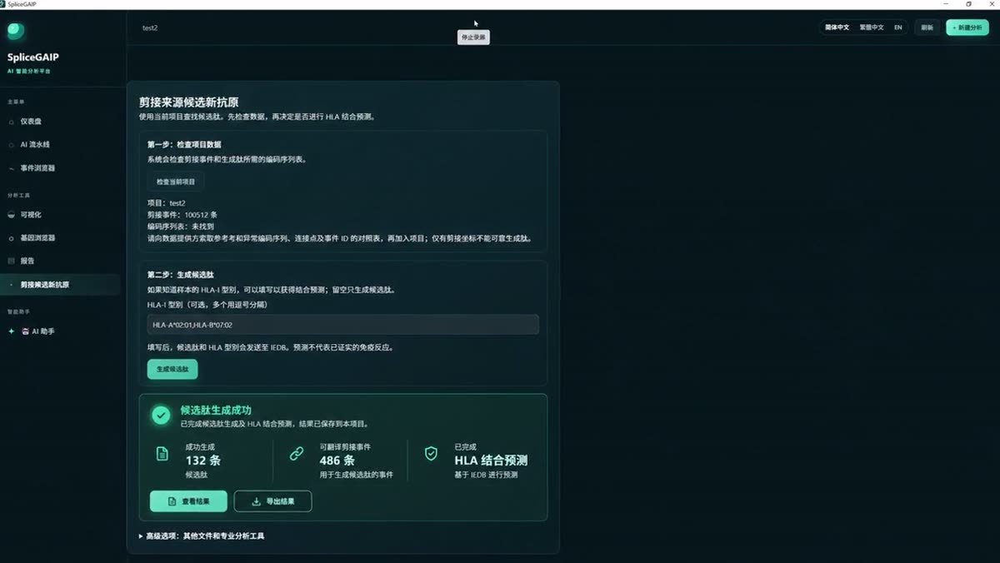
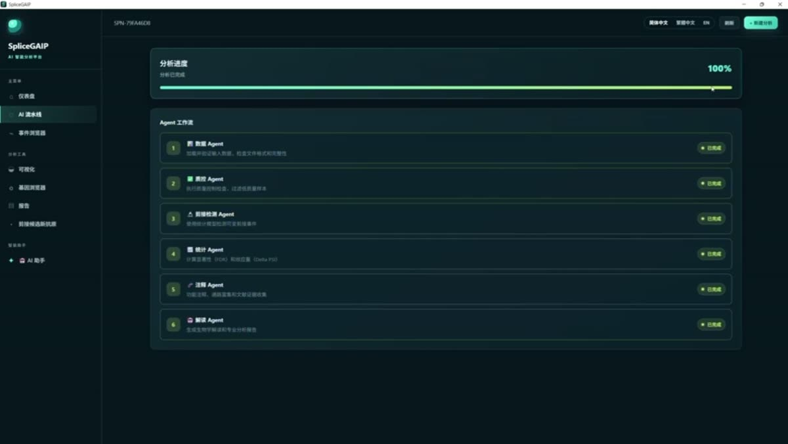

# SpliceGAIP

**AI-driven Alternative Splicing Analysis Agent Platform**

[簡體中文](README.md) ｜ **繁體中文** ｜ [English](README.en.md)

[](https://www.python.org/downloads/)
[](LICENSE)

SpliceGAIP 是在開源專案 [BioGAIP](https://github.com/zhangjy859/BioGAIP) 的多智慧體架構基礎上，結合剪接領域資料層（來自 SplicingNexus v2 的生產級事件標準化契約）重構而成的**面向可變剪接下游分析的 AI 智慧體平臺**。

自然語言驅動分析 → 自動生成分析流程 → 自動統計分析 → 自動解釋生物意義 → 自動生成科研報告。

> 本文件即《SpliceGAIP 能力手冊 v0.1.0》的完整 Markdown 版。帶樣式線上版見
> [能力手冊 HTML](docs/manual/SpliceGAIP_Capability_Manual_v0.1.0.html) ·
> [PDF](docs/manual/SpliceGAIP_Capability_Manual_v0.1.0.pdf)。

---

## 快速上手

```bash
# 1. 安裝（Python >= 3.10）
pip install -r requirements.txt

# 2. 執行完整分析（無需 LLM key；自治核心按資料自己決策）
python run.py analyze --input <已量化事件表目錄> --query "分析RNA剪接變化"
# 報告：runtime/projects/<PID>/report.html

# 3. 多輪追問 / 續跑
python run.py followup --project-id <PID> --query "zoom into TP53"

# 4. （可選）接入 LLM 增強
export MODEL_API_BASE_URL="https://api.deepseek.com"
export MODEL_API_KEY="sk-..."
export MODEL_NAME="deepseek-flash"

# 5. 介面
python run.py serve --api --port 8800   # FastAPI
python run.py serve --ui  --port 8501   # Streamlit 儀表盤
```

### 部署方式

| 形態 | 命令 |
|---|---|
| 🐳 Docker | `docker compose up -d`（API 8800 / UI 8501） |
| 💻 Windows EXE | `pyinstaller packaging/SpliceGAIP.spec` |
| 🔧 原始碼 | `python run.py serve --api --port 8800` |

### 演示與文件

| 材料 | 內容 |
|---|---|
| 📘 [能力手冊 HTML](docs/manual/SpliceGAIP_Capability_Manual_v0.1.0.html) · [PDF](docs/manual/SpliceGAIP_Capability_Manual_v0.1.0.pdf) · [Markdown](docs/manual/SpliceGAIP_Capability_Manual_v0.1.0.md) | v0.1.0：15 個功能模組、11 個規劃項、3 份附錄 |
| 🎬 [剪接來源候選新抗原 · 1:00](media/videos/splice-neoantigen-peptides.bilingual.mp4) | 事件 → 可翻譯肽 → HLA 結合預測 → 132 條候選肽（中英雙字幕軌） |
| 🎬 [完整分析流程 · 1:47](media/videos/pipeline-overview.bilingual.mp4) | 接入體檢 → 六 Agent 流水線 → 火山圖 / PSI 熱圖（中英雙字幕軌） |
| 🗒 [雙語講解稿](docs/WALKTHROUGH.md) | 逐句中英對照，可直接當配音稿 |

[](media/videos/splice-neoantigen-peptides.bilingual.mp4)
[](media/videos/pipeline-overview.bilingual.mp4)

> 兩段錄屏均為**無配音介面實錄**，講解以字幕形式提供：`*.bilingual.mp4` 內含中文 / English 兩條可切換字幕軌。

---

# SpliceGAIP 能力手冊

**版本**：v0.1.0（依據 2026-10-29 倉庫程式碼、`config/*.yaml`、`docs/` 與說明文件整理）
**適用物件**：分析人員（想知道能做什麼）、開發者（想知道改哪裡）、評審者（想知道邊界在哪）
**狀態圖例**：✅ 已上線可用 ｜ 🟡 部分上線（有條件/實驗性）｜ 🔵 開發中（規範已定、程式碼未落地）｜ ⚪ 規劃中（僅路線圖）

---

## 0. 一頁速覽

SpliceGAIP 是一個**面向"已完成可變剪接定量結果"的 AI 分析智慧體平臺**。它不接受 FASTQ，也不做比對；它接收 rMATS / SUPPA2 / MAJIQ / LeafCutter / 華大 RNAref 的已量化事件表，然後用一個**會自己決策、會自我質疑、會呼叫外部知識、會寫報告**的智慧體核心，產出可解釋、可復現、可發表的分析結果。

```
已量化剪接事件表  →  智慧接入與標準化  →  自治智慧體（觀察→決策→執行→校驗→反思）
                                              ↓
                 統計/排序/圖件 / 外部知識 / 假設檢驗 / 文獻證據 / 實驗室經驗
                                              ↓
                                   HTML+PDF 科研報告 / 分階段新抗原工作流
```

四條設計紅線（貫穿全部功能）：

1. 沒有模型 key 也必須能跑完（規則決策 + 離線 fallback，不是放錄影）。
2. 不得從座標猜序列、不得把單樣本描述性 PSI 說成"腫瘤特異"。
3. MHC 結合預測 ≠ 抗原呈遞 ≠ 免疫原性。
4. 每一次降級、放寬、跳過，都必須寫進報告的方法與侷限性。

---

## 1. 功能模組總覽

| # | 模組 | 一句話用途 | 狀態 | 主要入口 |
|---|---|---|---|---|
| M1 | 資料智慧接入 | 認表頭、認格式、認分組，把異構表格變成標準事件表 | ✅ | Web「資料接入」/ `POST /api/ingest/*` |
| M2 | 剪接事件解析與標準化 | 四類工具輸出 → 統一 `AS_event_master` 契約 | ✅ | `splicegaip/splicing/parsers/` |
| M3 | 統計分析與質量門控 | 卡方+BH FDR、閾值過濾、綜合評分排序 | ✅ | 智慧體動作 / `analysis/statistics.py` |
| M4 | 視覺化圖件 | 6 張標準圖 + 7 張按需圖，PNG 300dpi + SVG | ✅ | Web「視覺化」/ `analysis/*` |
| M5 | 自治智慧體核心 | OODA 迴圈、預算、自適應閾值、跨執行經驗 | ✅（預設） | `run.py analyze` / `agent/*` |
| M6 | 自我質疑（假設檢驗） | 解讀前用 5 個預註冊檢驗挑戰自己的結果 | ✅ | `agent/hypothesis.py` |
| M7 | 外部知識技能 | MyGene / PubMed / Enrichr / 剪接解讀接入迴圈 | ✅（需網路） | `skills/*` + `skills_bridge` |
| M8 | 文獻 RAG 與實驗室知識庫 | 證據檢索、跨專案復現基因沉澱 | ✅ | `knowledge/*`、`memory/` |
| M9 | 指令碼式多智慧體 | BioPlanner→BioAnalyst→BioInterpreter 固定流程 | ✅（相容保留） | `--agent-mode scripted` |
| M10 | LLM 增強層 | 8 項"寫作與理解"增強，無 key 自動降級 | ✅（需 key） | `llm/enrich.py` |
| M11 | 報告生成 | 自包含 HTML + PDF，六段式科學報告 | ✅ | Web「報告」/ `report/generator.py` |
| M12 | MCP 整合與 AI 助手 | 內建剪接工具服務端 + 自然語言→工具路由 | 🟡 | Web「AI 助手」/ `/api/mcp/*` |
| M13 | 剪接候選新抗原工作流 | 7 階段逐一確認，事件→肽→HLA 預測→六段報告 | 🟡 | Web「剪接候選新抗原」 |
| M14 | 多形態交付 | Web / 桌面 EXE / Docker / Coolify / CLI / API | ✅ | `run.py serve`、`dist/` |
| M15 | 可觀測性與可復現 | 全鏈路日誌、SQLite 記憶、輸入指紋 | ✅ | `observability.py`、`runtime/` |

---

## 2. 已有功能詳解

每個模組統一按「核心用途 → 使用方式 → 輸入/輸出 → 適用場景」說明。

### M1 資料智慧接入（異構表格 → 標準事件表）

**核心用途**
不要求使用者先把資料整理成某一種格式。系統掃描目錄（含子目錄），識別表頭與分隔符，判斷"這是剪接事件表 / 表達矩陣 / 轉錄本定量 / 後設資料"，再決定怎麼接。

**使用方式**
1. Web 進入「AI 流水線」上傳檔案或目錄 → 自動出預覽（只讀表頭與最多三行樣例，不遍歷全表）。
2. 對未見過列名的表格，已配置的模型會拿到列名 + 樣例，提出**對映建議**；建議必須通過"列是否真實存在"的校驗，並由使用者確認後才寫入。
3. 華大 RNAref 單樣本報告（`OC_001/OC_001.SE.xls` 等）會先被識別，再由使用者**手工指定每個樣本的生物學分組**，系統合併為 `standardized/AS_event_master.tsv` + `sample_metadata.tsv`。
4. 也可直接調介面：`POST /api/ingest/preview` → `POST /api/ingest/groups` → `POST /api/ingest/apply`。

**輸入 / 輸出**

| 項 | 內容 |
|---|---|
| 輸入 | `.csv/.tsv/.txt/.tab`、製表符文本 `.xls`、真 Excel `.xls/.xlsx/.xlsm`、對應文本表的 `.gz` |
| 輸出 | `standardized/AS_event_master.tsv`、`sample_metadata.tsv`、識別報告（每個檔案的角色與告警） |
| 拒絕 | 表達量矩陣（FPKM/TPM/read_count）→ 提示"請另選剪接事件結果"；轉錄本定量（Bambu 等）→ 識別但不進事件流程 |

**適用場景**
- 手上是華大/諾禾等公司的單樣本剪接報告，只有描述性 PSI，沒有 p 值。
- 手上是各工具混用的歷史結果，需要先統一再分析。
- 不確定某個檔案到底是事件表還是表達矩陣。

**邊界（必須知道）**
- 單樣本報告沒有組間檢驗，輸出的 `p_value`/`FDR` **保持空白**，不能據此聲稱顯著差異剪接。
- 分組永遠由人確認，模型不猜分組。
- 只有 p 值沒有 FDR 時，通用接入器只能對**當前完整事件表**做 BH；如果公開檔案只是顯著子集，必須補原始完整結果的 FDR。

---

### M2 剪接事件解析與標準化

**核心用途**
把不同工具的輸出摺疊成同一套事件契約（`event_id / gene_id / event_type / PSI / ΔPSI / p / FDR` + 質量列），後續所有統計、排序、報告都建立在這一層之上。

**使用方式**
自動識別，無需手動指定解析器（目錄裡放對檔名即可）：

| 輸入 | 說明 |
|---|---|
| `SE.MATS.JC.txt` 等 rMATS 5 類 + `sample_metadata.tsv` | 含 0-based→1-based 座標轉換、逐樣本 PSI 展開 |
| SUPPA2 `*.psi.tsv` | ΔPSI 來自均值差或外部檔案 |
| MAJIQ TSV（含 `dPSI` / `P(dPSI)`） | 自動對映 |
| LeafCutter `*_cluster_significance.txt` | 自動對映 |
| `AS_event_master.tsv` | 直接讀取（已是標準表） |

**輸入 / 輸出**
- 輸入：上述任一事件表 + 可選 `sample_metadata.tsv`（`sample_id, group, condition, tissue, batch`）
- 輸出：記憶體中的 `Dataset`（events / samples / validation）+ 落盤的標準表 + 校驗告警

**適用場景**
同一課題裡 rMATS 和 SUPPA2 混用；換工具後想複用同一套下游；做跨專案比較前先對齊契約。

---

### M3 統計分析與質量門控

**核心用途**
判斷"哪些事件真的變了"，並把候選按證據強度排出先後。

**使用方式**
預設全部自動執行；也可在 CLI/配置裡改閾值（`config/config.yaml → analysis`）：

| 引數 | 預設 | 含義 |
|---|---|---|
| `fdr_threshold` | 0.05 | 顯著性門 |
| `delta_psi_threshold` | 0.10 | 效應量門 |
| `min_support_reads` | 10 | junction 支援讀數下限 |
| `min_valid_samples` | 2 | 每組最少有效樣本 |
| `top_candidates` | 20 | 保留候選數 |
| `enrichment_alpha` | 0.05 | 富集術語 FDR |

**輸入 / 輸出**
- 輸入：標準化事件表（M2 產物）
- 輸出：顯著事件集合、候選排序表、富集結果（GO/KEGG/Reactome/MSigDB）、每步的通過/剔除計數
- 方法：卡方檢驗 + BH FDR；綜合評分 = 0.4×顯著性 + 0.3×效應量 + 0.2×生物學 + 0.1×文獻

**適用場景**
標準兩組對照（腫瘤 vs 正常、處理 vs 對照）；需要一份"能寫進論文 Methods"的閾值與剔除理由。

---

### M4 視覺化圖件

**核心用途**
出可直接進投稿或彙報的圖，而不是給開發看的除錯圖。

**使用方式**
- 標準 6 圖隨分析自動生成，落在 `runtime/projects/<id>/figures/`：`volcano`、`event_type_counts`、`psi_heatmap`、`psi_distribution`、`candidate_ranking`、`enrichment`。
- 按需 7 圖在 Web「視覺化」頁觸發：ΔPSI 瀑布圖、ΔPSI ECDF、FDR scree、事件顯著性散點、評分分解、樣本構成、事件結構示意。
- 取圖：`GET /api/figure/{project_id}/{figure_name}`。

**輸入 / 輸出**
輸入為已持久化的專案狀態（無需重跑分析）；輸出 PNG（300 dpi）+ SVG 雙份，缺資料時輸出帶說明的佔位圖而不是空白報錯。

**適用場景**
組會彙報、論文 Figure 1–3、審稿人要求補充圖。

---

### M5 自治智慧體核心（預設模式）

**核心用途**
讓流程按資料自己走，而不是按寫死的指令碼走。

```
觀察(Profile) → 校驗(Verify) → 決策(Decide) → 執行(Act) → 記錄(Trace)
      ↑                                              │
      └──────── 目標未達成 → 反思重試 / 重規劃（有預算） ┘
```

**使用方式**

```bash
# 預設 agentic：智慧體自己看資料、自己定閾值
python run.py analyze --input examples/demo_rmats --query "分析RNA剪接變化"

# 想在人把關下跑：聯網呼叫 / 放寬閾值 / 接受阻塞問題會先問你
python run.py analyze --input data/ --query "..." --autonomy assisted

# 多輪追問：在已有專案上續跑，不重跑整條流水線
python run.py followup --project-id <PID> --query "zoom into TP53"
python run.py followup --project-id <PID> --query "只看 SE 事件"
```

**核心機制與可調項**（`config.yaml → agent`）

| 機制 | 說明 | 配置 |
|---|---|---|
| 目標驗收 | 用可判定的驗收標準取代"終止令牌" | `state.py` |
| 資料畫像 | 規模、FDR 覆蓋率、缺失、支援讀數、組平衡 | `profile.py` |
| 自適應閾值 | 預設門篩出 0 個事件時，按分佈放寬到能出結果處，並記錄**為什麼改** | `adaptive_thresholds: true`、`target_significant: 100` |
| 結果體檢 + 補救 | 產出 Issue(code, severity, suggestion) → 改閾值/重試/降級接受 | `reflection: true` |
| 硬預算 | 步數 / 時間 / 錯誤三重上限，絕不無限迴圈 | `max_steps: 20`、`max_seconds: 900`、`max_errors: 3` |
| 跨執行經驗 | 相似資料上次用什麼閾值成功過 | `episodic: true` |
| 多輪會話 | 狀態快照 save/load + 規則化意圖解析 | `session.py` |
| 人在迴路 | 三類高風險決策先問人，`auto` 模式自動批准但留痕 | `autonomy`、`interactive.py` |

**內建動作（共 19 個）**
- 資料類：`profile_dataset`、`assess_quality`
- 分析類：`summarize_dataset`、`filter_significant_events`、`rank_candidates`、`run_enrichment`、`generate_figures`、`deep_dive_gene`、`adapt_thresholds`
- 自我質疑：`test_hypothesis`
- 外部知識：`annotate_genes`、`annotate_genes_enhanced`、`enrich_pathways`、`enrich_pathways_bioservices`、`search_literature`、`interpret_splice_event`
- 交付類：`collect_literature_evidence`、`interpret_candidates`、`generate_report`
- 經驗類：`consult_knowledge`、`persist_knowledge`

**適用場景**
資料不合"教科書分佈"（事件太少、FDR 缺失、組不平衡）；需要在報告裡誠實交代"為什麼最後用了 FDR<0.1"；無人值守跑批次專案。

---

### M6 自我質疑：預註冊假設檢驗

**核心用途**
在下結論之前，先系統性地挑戰自己的結果，被拒絕的檢驗直接變成報告裡的侷限性。

**使用方式**
`hypothesis_testing: true` 時自動在解讀前執行，無需呼叫；CLI/介面也可單獨觸發。

| 檢驗 | H0 | 方法 |
|---|---|---|
| `dpsi_shift` | ΔPSI 分佈未偏離 0 | Wilcoxon 符號秩（小樣本退化 t 檢驗） |
| `direction_balance` | 上調/下調均衡 | 二項檢驗 |
| `event_type_bias` | 顯著事件型別構成 = 背景構成 | 卡方擬合優度 |
| `coverage_confound` | 效應量與測序深度無關 | Spearman 秩相關 |
| `gene_recurrence` | 命中不集中於少數基因 | 置換檢驗（1000 次） |

**輸入 / 輸出**
輸入為當前候選與事件集合；輸出為逐項 p 值 + BH 校正 + 結論，寫入報告 3.3 節與 Limitations。例如 demo 資料上 `coverage_confound` 被拒絕，報告就會主動宣告"大 ΔPSI 事件受測序深度混雜"。

**適用場景**
審稿人問"你怎麼排除測序深度混雜"；內部質控要求"每個結論都有對應的證偽嘗試"。

---

### M7 外部知識技能（4 項）與開源後端

**核心用途**
把"查一下這個基因是什麼、有沒有文獻、富集到什麼通路、這個剪接事件該怎麼解讀"變成智慧體可自主呼叫的動作。

**使用方式**
- 智慧體自動呼叫（`agent.skills.enabled: true`，預設開）。
- 單獨呼叫：`GET /api/skills/list` 取 schema，`POST /api/skills/execute` 執行。
- 關閉：`--skills off` 或 `SPLICEGAIP_ENABLE_SKILLS=0`。

| 技能 | 後端 | 用途 |
|---|---|---|
| `gene_annotation` | MyGene.info | 基因符號 / Ensembl / UniProt 註釋，支援批次 |
| `literature_search` | PubMed | 按基因/事件檢索文獻並摘要 |
| `pathway_enrichment` | Enrichr（GSEApy） | GO / KEGG / Reactome / MSigDB 過表徵分析 |
| `splice_interpretation` | 本地規則 + 模型 | 解釋特定剪接事件的生物學後果 |

**橋接層的四個保證**：sync/async 隔離、單次超時（預設 10 s）、**每執行呼叫預算**（預設 4 次）、同參數快取；失敗即降級——網路掛了不會拖垮分析，只會記一條侷限性。

**輸入 / 輸出**
輸入為基因列表 / 事件 / 術語集；輸出為結構化結果 + 資料來源與版本。可用性通過 `capabilities()` 暴露給 API 與報告（`gseapy` / `mygene` / `scipy` / `httpx` 是否裝好、什麼版本）。

**適用場景**
候選基因需要一句話功能註釋；報告需要"文獻支援度"；離線環境需要確認哪些能力當前不可用。

---

### M8 文獻 RAG 與實驗室知識庫

**核心用途**
兩層記憶：一層是"文獻證據庫"，一層是"本實驗室歷史上反覆出現的基因"。

**使用方式**
- 文獻：`knowledge/rag.py`（內建知識庫 + PubMed + SQLite 文獻庫，NFS 安全），檢索結果作為解讀證據注入。
- 實驗室知識：`consult_knowledge` 在解讀前查庫（預設要求 ≥2 個歷史專案命中），`persist_knowledge` 在成功執行後把 Top 候選寫回 `lab_knowledge.sqlite3`。
- 報告呈現：5.5「外部知識發現」與 5.6「實驗室級復現」。

**輸入 / 輸出**
輸入為候選基因、查詢詞、專案歷史；輸出為帶來源的文獻條目、跨專案復現基因表。

**適用場景**
同一實驗室連續做多個腫瘤佇列，希望"這個基因我們第三次看到了"這件事自動浮出來；需要證據可追溯而不是模型憑記憶說話。

---

### M9 指令碼式多智慧體（相容模式）

**核心用途**
保留 BioGAIP 的經典三角色流水線，用於**迴歸對比**和教學演示：同一份資料，agentic 與 scripted 應當給出可解釋的差異。

**使用方式**
```bash
python run.py analyze --input examples/demo_rmats --query "分析RNA剪接變化" --agent-mode scripted
```
或在 `config.yaml` 設 `agent.mode: scripted`、或環境變數 `SPLICEGAIP_AGENT_MODE`。

**結構**
```
BioPlanner（只規劃，不計算） → BioAnalyst（summarize→filter→rank→enrich→figures）
                            → BioInterpreter（文獻→解讀→報告，終止令牌 SPLICEGAIP_DONE）
```
角色與工具在 `config/agent_config.yaml` / `tool_config.yaml` 宣告；`max_turns: 40`；Agent 間用結構化訊息協作，全部操作寫入 SQLite Analysis Memory。

**輸入 / 輸出**
輸入同 M5；輸出同 M11，但閾值固定（FDR<0.05 且 |ΔPSI|>0.1），不做自適應。

**適用場景**
版本升級後的行為對比；需要"每次執行結果完全一致"的確定性場景；給新人講清平臺的三段式職責劃分。

---

### M10 LLM 增強層（8 項）

**核心用途**
模型只負責"理解與表達"，不負責"算出數字"。8 項能力可逐項開關：

| 特性 | 作用 |
|---|---|
| `understand` | 自然語言分析目標理解 + 引數建議（`POST /api/understand`） |
| `plan` | Planner 的目標與侷限性措辭精煉 |
| `interpret` | 結果的敘述性解讀（導語 / 段落 / 要點） |
| `annotate` | 候選基因生物學註釋 |
| `literature` | 文獻證據摘要 |
| `limitations` | 補充研究設計層面的侷限性 |
| `hypotheses` | 研究假設 + 驗證實驗建議 |
| `critique` | 對生成敘述做自動審查（可用 `MODEL_CRITIC_NAME` 單獨指定審查模型） |

**使用方式**
三種配置途徑任選：環境變數 / 專案根目錄 `.env` / 介面「AI 助手 → 模型配置」。

```bash
export MODEL_API_BASE_URL="https://api.deepseek.com"
export MODEL_API_KEY="sk-..."
export MODEL_NAME="deepseek-flash"
export MODEL_THINKING=auto      # 工具呼叫關推理、報告解讀開推理
```

**關鍵引數**：單次超時 120 s、每執行最多 16 次呼叫、最多 8 個基因註釋、輸出語言 `auto`（跟隨提問語種，可強制 zh/en）、`provider: auto`（自動識別 deepseek/openai/moonshot/dashscope）、URL 中的金鑰自動脫敏。

**輸入 / 輸出**
輸入為結構化分析結果 + 使用者查詢；輸出為文本段落 / JSON 建議，**必須經過本地校驗**（建議的列名、引數、基因必須真實存在）。

**適用場景**
需要一段人話總結給臨床或生物同事；需要模型幫著寫 Limitations；想在無 key 的伺服器上跑但本地有 key 時臨時增強。

**降級行為**
無 key / 端點不通 → `fallback.py` 的離線確定性策略接管，報告照常生成，只是少了敘述潤色，並在狀態裡標明"未使用模型"。

---

### M11 報告生成

**核心用途**
一次執行結束，直接拿到能發出去的東西。

**使用方式**
自動生成；或 Web「報告」頁下載；或 `GET /api/report/{project_id}?format=html|pdf`。

**輸出結構**
```
runtime/projects/<project_id>/
├── figures/        # PNG 300dpi + SVG
├── report.html     # 自包含（圖片 base64 內嵌，可單檔案傳閱）
└── report.pdf      # reportlab 渲染
```
章節：Summary / Methods / Results（含 3.3 統計假設檢驗）/ Figures / Biological Interpretation（含 5.5 外部知識、5.6 實驗室復現）/ Limitations / References。

**特點**
方法學留痕：閾值、放寬理由、軟體版本、跳過步驟、被拒絕的假設檢驗全部進正文，而不是塞在附錄裡。

**適用場景**
組會彙報、投稿附件、給合作方的階段性交付、內部質控歸檔。

---

### M12 MCP 整合與 AI 助手

**核心用途**
把平臺能力**對外暴露成標準工具**，並讓自然語言可以直接驅動這些工具。

**使用方式**
- 內建服務端 `splicegaip-builtin`（`http://127.0.0.1:9100`，隨程序可用，無需配置），提供 5 個工具：`list_projects`、`project_summary`、`search_events`、`explain_event_type`、`compute_delta_psi`。
- 外部服務端：寫 `~/.splicegaip/mcp/servers.json`，支援 `stdio` / `sse` / `http` 三種傳輸、官方 MCP SDK 與簡易 `/tools` 適配兩種協議。
- 檢視與呼叫：`GET /api/mcp/servers`（含連線狀態與工具 schema）、`POST /api/mcp/call`、`POST /api/mcp/agent`（自然語言 → 選工具 → 本地校驗 → 執行）。
- Web「AI 助手」頁可填自然語言指令，例如"查一下 CD44 有哪些顯著剪接事件"。

**輸入 / 輸出**
輸入為自然語言問題 + 可選 `project_id`；輸出為工具呼叫結果。模型只提出 `{server, tool, arguments}`，**校驗與執行留在本地**；無模型時確定性路由器按同一契約兜底。

**適用場景**
讓 IDE 裡的編碼助手直接查專案結果；把平臺接進實驗室已有的 Agent 工作流；給非技術同事一個"問一句話就出數"的入口。

**現狀說明**
工具路由與執行鏈路已通；但「AI 流水線」頁那份雙欄對話面板（v4 描述）仍是**前端演示態**——訊息為模板渲染，未接真實多輪對話後端。這是 M12 與規劃項 P7 的分界。

---

### M13 剪接候選新抗原工作流（分階段）

**核心用途**
從"剪接事件"再往下走一層，走到"候選肽 + HLA 結合預測"，且**每一步都必須人工確認**，不允許一把梭。

**使用方式**
Web「剪接候選新抗原」→ 選專案 → 表單 → 逐階段確認推進；進度存本機執行目錄，重啟可恢復；專案輸入一變，指紋不匹配就強制重新審計。

| 階段 | 做什麼 | 必須提供 | 拒絕/停止條件 |
|---|---|---|---|
| 0 審計 | 宣告這份資料最多能支撐到第幾步 | `normal_design`、`genome_build`、`annotation_version`、`coordinate_system`、`input_kind`、`hla_source`、`hla_confidence` | 關鍵宣告缺失即不進入後續階段 |
| 1 事件 | 使用上游已量化事件，不重新發現 | 明確確認"輸入是已量化事件表" + 事件表完整性宣告 | 原始 reads/BAM 不支援；event_id 為空或重複即拒絕 |
| 2 事件過濾 | 座標層過濾 | 支援讀數閾值、最小樣本數、且須確認該讀數是否為 junction 支援 | 無事件存活 → 流程停止並記錄 |
| 3 ORF | 讀入**上游重建**的 ORF 表 | 四個 CDS 列 + `orf_source`、`frame_status`、`premature_stop`，可選 `last_junction_nt` | 缺欄位即拒絕；不自行重建 ORF |
| 4 肽級正常過濾 | 配對正常 / GTEx / 全蛋白組三層精確匹配 + GTEx junction + 正常組織表達 | 三層 FASTA、事件與 GTEx 連線點表（同基因組版本）、正常表達表 | 跳過任一層須顯式承認侷限，否則報錯 |
| 5 表達與復現率 | 是否有轉錄本、是否多患者復現 | `event_id, expression, expression_unit`，可選 `recurrence_count/total` | 復現率只作排序權重，不當硬門檻 |
| 6 HLA 預測 | IEDB **NetMHCpan 4.1 EL** | 真實 HLA-I 型別（如 `HLA-A*02:01`）+ 來源 + 置信度 | 組合數 >200 拒絕；預測失敗逐條記入 manifest |
| 7 輸出 | 固定六段報告 | — | — |

**輸入 / 輸出**
- 輸入：專案資料目錄內的全部檔案（越界路徑直接拒絕），CDS 表 / ORF 表 / FASTA / 連線點表 / 表達表
- 輸出：`splice_peptides.tsv`、`mhc_i_predictions.tsv`、`neoantigen_manifest.json`（含跳過原因與預測錯誤）、六段結構化結果

**另有兩項獨立能力**
- 獨立肽生成：`neoantigen.run()` 直接吃 CDS 對照表（`event_id, reference_cds, altered_cds, junction_nt`），翻譯到首個終止密碼子，保留跨連線點的 8–11 aa 肽，排除正常 ORF 內已出現的肽。
- moPepGen 適配：`scripts/mopepgen_docker.py` 調官方 1.4.6 容器，產出變異事件 GVF 與變異肽 FASTA，並儲存命令、輸入 SHA-256、映象摘要與日誌。**它不產出本流程階段 3 需要的 CDS 對照表，也不是 HLA 預測**。

**適用場景**
已有配對 normal 與 HLA 分型、想快速得到"值得做實驗驗證"的候選清單；需要在方法學審查下交付"誠實的半程結果"。

**邊界（寫死在程式碼裡）**
不猜序列；不把預測當呈遞；不把單樣本當腫瘤特異；不做綜合評分排序（明確宣告"未定義有證據支援的綜合評分"）。

---

### M14 多形態交付

**核心用途**
同一套核心，四種用法：給自己跑、給同事用、給伺服器部署、給其他 Agent 調。

| 形態 | 入口 | 適用 |
|---|---|---|
| CLI | `run.py analyze / followup / projects / status / serve` | 批次、指令碼化、復現 |
| Web 單頁應用 | `python run.py serve --ui` 或 `python serve_ui.py`；9 個頁面：儀表盤 / AI 流水線 / 事件瀏覽器 / 視覺化 / 基因瀏覽器 / 報告 / 剪接候選新抗原 / AI 助手 | 日常分析主入口 |
| 桌面視窗 | `desktop_ui.py`（pywebview 包一層本地服務）；`dist/SpliceGAIP.exe` 免 Python | 給不裝環境的同事 |
| API | FastAPI（預設 8800）：分析、接入、狀態、報告、圖件、技能、MCP、新抗原 | 整合與自動化 |
| 容器 | `docker compose up -d`（API 8800 + UI 8501）；Coolify 一鍵；`nginx.conf` 反代 | 團隊/伺服器部署 |

**Streamlit 儀表盤**另有獨立入口（`serve --ui`，預設 8501），頁面為「上傳+目標 → 結果（候選/圖/富集）→ 下載報告」。

**適用場景**
本地探索用桌面版；團隊共享用 Docker/Coolify；流水線整合用 API/CLI；無 Python 環境用 EXE。

---

### M15 可觀測性與可復現

**核心用途**
讓"這個結論是怎麼來的"永遠可追。

**機制**
- 每次執行記錄：輸入指紋、分析計劃、生成程式碼、結果、解釋、工作流日誌（SQLite Analysis Memory）。
- 日誌：`observability.py` 統一結構化輸出，級別/來源/時間齊全。
- 狀態庫預設寫本地磁碟（`/var/tmp/splicegaip`；Windows 為系統臨時目錄），因為 NFS 不支援 SQLite 檔案鎖——程式會自動探測並遷移。
- 決策軌跡：每一步"觀察到了什麼 → 為什麼這麼決定"都進 report Methods 與 workflow log。

**適用場景**
半年後要復現一張圖；審稿人質疑閾值；交接給下一個學生。

---

## 3. 已有功能清單（按"能立刻用"排序）

| 能力 | 命令 / 入口 | 依賴 | 狀態 |
|---|---|---|---|
| 一鍵完整分析（離線可用） | `run.py analyze --input ... --query ...` | Python 3.10+ | ✅ |
| 自適應閾值與自我糾錯 | 預設開啟 | — | ✅ |
| 多輪追問 | `run.py followup --project-id ... --query ...` | 已有專案 | ✅ |
| 5 項假設檢驗 | 預設開啟 | scipy | ✅ |
| 4 項外部知識技能 | 預設開啟 | 網路 + `gseapy`/`mygene`/`httpx` | ✅（缺依賴自動降級） |
| 8 項 LLM 增強 | `.env` 配 key | 模型端點 | ✅（無 key 降級） |
| HTML + PDF 報告 | 自動 / `GET /api/report/{pid}` | reportlab | ✅ |
| 13 張圖件 | 自動 + 視覺化頁按需 | matplotlib | ✅ |
| 6 類輸入格式自動識別 | 上傳目錄 | — | ✅ |
| 華大 RNAref 單樣本接入 | 接入嚮導 | 人工分組 | ✅ |
| MCP 內建 5 工具 | `GET /api/mcp/servers` | — | ✅ |
| 外部 MCP 服務端接入 | `~/.splicegaip/mcp/servers.json` | `mcp` SDK | ✅ |
| 自然語言 → MCP 工具路由 | `/api/mcp/agent` | 模型（可選） | 🟡（無模型走確定性路由） |
| 新抗原 7 階段工作流 | Web 新抗原頁 | 使用者自備 ORF/FASTA/HLA | 🟡（實驗性，逐階段確認） |
| 獨立肽生成 | `neoantigen.run()` | CDS 對照表 | 🟡 |
| moPepGen 容器適配 | `scripts/mopepgen_docker.py` | Docker + 映象 | 🟡（探索性，不接 ORF 階段） |
| 桌面 EXE | `dist/SpliceGAIP.exe` | — | ✅ |
| Docker / Coolify 部署 | `docker compose up -d` | Docker | ✅ |
| 人機互動確認 | `--autonomy assisted` | — | ✅ |

---

## 4. 規劃中 / 開發中功能

> 狀態判定標準：**🔵 開發中** = 規範與介面契約已在倉庫中定義（文件/配置/欄位），但核心實現未落地；**⚪ 規劃中** = 僅出現在路線圖或配置註釋中，無程式碼痕跡。

### P1 自動 ORF 重建（新抗原階段 3 的自動化）

| 項 | 內容 |
|---|---|
| **預期目標** | 輸入事件表 + 參考基因組 FASTA + GTF/CDS 註釋，自動按事件型別（SE/RI/A3SS/A5SS/MXE）拼接 novel transcript，判定 in-frame / frameshift，翻譯至首個終止密碼子，計算 `junction_nt`，並按 50 nt 距離規則給出 NMD 候選 |
| **解決的具體問題** | 目前階段 3 必須由使用者提供"已重建的 ORF 表"，這是整條鏈路里人工成本最高、最容易出錯的一步；沒有它，新抗原分析對絕大多數使用者直接斷在第三步 |
| **當前狀態** | 🔵 開發中：`docs/prompts/splice-neoantigen-pipeline.md` 已把階段 3 的方法學與欄位契約寫死（`orf_source` / `frame_status` / `premature_stop` / `last_junction_nt`），程式碼中明確宣告"自動 ORF 重建尚未實現" |
| **使用示例（預期）** | `新抗原頁 → 階段 3 → 選擇基因組 FASTA + GTF → 一鍵重建 → 自動產出四列 CDS 表 + NMD 標記，人工抽查後確認進入階段 4` |
| **依賴/風險** | 轉錄本註釋版本必須與事件座標一致；不同事件型別的拼接規則不同，誤拼會靜默產生假肽——因此必須有逐事件可追溯的拼接日誌 |

### P2 原始資料線上處理（Phase 2：FASTQ → 比對 → 剪接檢測）

| 項 | 內容 |
|---|---|
| **預期目標** | 平臺上直接完成 FASTQ 質控 → STAR/HISAT2 比對 → rMATS/SUPPA2 線上執行 → 自動進入現有分析鏈路 |
| **解決的具體問題** | 當前 Phase 1 只吃"已量化事件表"，使用者必須在命令列裡自己跑完一整套生信流程才能用上平臺；這把非生信背景的使用者擋在門外 |
| **當前狀態** | ⚪ 規劃中（README 路線圖 Phase 2；目錄中無比對/定量程式碼） |
| **使用示例（預期）** | `上傳 6 個 FASTQ + sample_metadata.tsv → 選擇 GRCh38/GENCODE → 平臺排隊跑比對與 rMATS → 自動生成 SE.MATS.JC → 直接進智慧體分析` |
| **依賴/風險** | 需要重型算力與任務佇列；參考基因組版本管理；執行時間從分鐘級升到小時級 |

### P3 專用 QC 智慧體

| 項 | 內容 |
|---|---|
| **預期目標** | 獨立的質控角色，在分析前對測序深度、比對率、樣本相關性、批次效應做系統體檢並給出"能否繼續"的判定 |
| **解決的具體問題** | 現在質控散落在 `profile_dataset` / `assess_quality` 兩個動作與假設檢驗中，缺少一個"專職說不"的角色；壞資料仍可能被一路分析下去 |
| **當前狀態** | ⚪ 規劃中（`config/agent_config.yaml` 註釋明確寫"future extensions (e.g. a dedicated QC agent in Phase 2)"） |
| **使用示例（預期）** | `執行前自動插入 QC 階段 → 檢出樣本 3 與其餘樣本相關性 <0.7 → 報告建議剔除並給出依據 → 使用者確認後繼續或中止` |

### P4 轉錄本定量獨立流程（長讀長 / Bambu 等）

| 項 | 內容 |
|---|---|
| **預期目標** | 把逐轉錄本 count/CPM/TPM 矩陣當作獨立資料型別分析（差異轉錄本使用、isoform switch），而不是硬塞進事件 PSI 流程 |
| **解決的具體問題** | 目前長讀長資料能被"識別"但明確"不進本流程"，使用者拿到識別結果後無路可走 |
| **當前狀態** | ⚪ 規劃中（README 已宣告"轉錄本定量分析是獨立資料型別，尚未接入本流程"） |
| **使用示例（預期）** | `上傳 Bambu 的 transcript count 矩陣 → 選擇"轉錄本定量分析" → 輸出 isoform 使用差異 + isoform switch 圖` |

### P5 單細胞 RNA-seq 與多組學（Phase 3）

| 項 | 內容 |
|---|---|
| **預期目標** | 單細胞層面的剪接分析（cell-type 特異 PSI）、與轉錄組/蛋白組/甲基化的聯合分析 |
| **解決的具體問題** | 現有全部統計假設建立在 bulk 組間比較上，無法回答"哪個細胞亞群發生了這個剪接改變" |
| **當前狀態** | ⚪ 規劃中（路線圖 Phase 3） |
| **使用示例（預期）** | `上傳 scRNA-seq 的 splice junction count → 按細胞型別聚類 → 輸出亞群特異剪接事件與標記基因聯動` |

### P6 自主生物資訊學研究員（Phase 4）

| 項 | 內容 |
|---|---|
| **預期目標** | 從"給定資料和目標"進化到"給定科學問題"，自主提出假設、設計分析、迭代驗證、撰寫可投稿文稿 |
| **解決的具體問題** | 當前智慧體的自主性侷限於"在既定流水線內做決策"，科學問題的提出仍完全依賴人 |
| **當前狀態** | ⚪ 規劃中（路線圖 Phase 4，遠景） |
| **使用示例（預期）** | `輸入"這批腫瘤樣本為什麼對某藥不敏感" → 自主生成剪接相關假設 → 設計並執行驗證分析 → 輸出帶證據鏈的研究報告` |

### P7 AI 助手完整多輪對話

| 項 | 內容 |
|---|---|
| **預期目標** | 把「AI 流水線」頁的雙欄對話面板接上真實後端：真實 LLM 回覆、WebSocket 流式、多輪上下文記憶、Agent 協作視覺化 |
| **解決的具體問題** | 目前對話面板的訊息是前端模板渲染，使用者問"為什麼選這個 FDR 閾值"得不到真實回答；而 MCP 工具路由已經能用，兩者之間缺一層"對話殼" |
| **當前狀態** | 🟡 部分上線：`/api/mcp/agent`（自然語言→工具→本地執行）已通，`/api/understand`（目標理解）已通；面板本身仍為演示態 |
| **使用示例（預期）** | `在面板輸入"為什麼不選 FDR 0.01" → 智慧體讀取本次執行的狀態與決策軌跡 → 回答"0.01 下僅剩 2 個事件，低於驗收標準 100，因此放寬到 0.05 並記錄在 Methods"` |
| **依賴** | 需要把 `AgentState` 與決策軌跡暴露為可查詢的會話上下文；WebSocket 通道 |

### P8 新抗原候選綜合評分

| 項 | 內容 |
|---|---|
| **預期目標** | 定義一個**有證據支援**的綜合評分（表達 × 復現率 × 結合 rank × 事件質量），用於候選排序 |
| **解決的具體問題** | 當前六段報告明確寫"未定義有證據支援的綜合評分，候選表未作綜合評分排序"，使用者拿到候選表後仍需自己排序 |
| **當前狀態** | ⚪ 規劃中（`neoantigen_workflow.py` 侷限性中顯式宣告） |
| **使用示例（預期）** | `階段 7 輸出按綜合評分降序的候選表，並顯示每項權重貢獻` |

### P9 內建參考資料庫與版本管理

| 項 | 內容 |
|---|---|
| **預期目標** | 內建/託管 GTEx junction 表、UniProt 全蛋白組、常見基因組版本的 CDS 註釋，並做版本一致性校驗 |
| **解決的具體問題** | 階段 4 現在要求使用者自備三層 FASTA 與連線點表，且"基因組版本需一致"完全靠人核對；這是新抗原流程第二個高門檻 |
| **當前狀態** | ⚪ 規劃中（文件反覆強調"檔案來源、覆蓋範圍及版本須由使用者核實"） |
| **使用示例（預期）** | `階段 4 下拉選擇 GTEx v8 / UniProt 2024_05 / GRCh38 → 系統自動校驗事件構建版本並提示不匹配項` |

### P10 MHC-II 與免疫肽組證據（文件提及，未排期）

| 項 | 內容 |
|---|---|
| **預期目標** | 支援 MHC-II 預測模型；接入 HLA 免疫肽組質譜證據 |
| **解決的具體問題** | 當前僅 MHC-I（8–11 aa, NetMHCpan 4.1 EL），CD4+ T 細胞相關候選完全缺失；且無法確認肽是否真被呈遞 |
| **當前狀態** | ⚪ 規劃中（提示詞中明確"MHC-II 是另一套模型，不要混用"，屬方法學提醒而非功能承諾） |

### P11 工程質量項（非功能，但影響可用性）

| 項 | 現狀 | 目標 |
|---|---|---|
| 測試覆蓋率 | 27%，CI 門檻 20% | 逐步提高門檻；補齊資料處理、Agent、UI 覆蓋 |
| 文件完整度 | `docs/` 僅 `prompts/`；README 引用的 `docs/USAGE.md` 缺失 | 補齊操作手冊（本檔案為第一步） |
| 日誌/安全 | 已有結構化日誌與金鑰脫敏 | 生產級檔案輪轉、許可權模型 |

---

## 5. 新舊功能關係與演進方向

### 5.1 演進主線（一張圖看清）

```
v1 固定指令碼三智慧體（BioPlanner→BioAnalyst→BioInterpreter）
        │  問題：閾值寫死，資料不合假設就交出空結果
        ▼
v2 自治核心 OODA（決策引擎 + 校驗 + 反思 + 預算 + 跨執行經驗）
        │  問題：會決策但不會懷疑自己，也不會找外部證據
        ▼
v3 自我質疑 + 外部知識 + 人在迴路（5 項假設檢驗 / 4 項技能 / assisted 模式）
        │  問題：bulk 事件層到頂了，使用者還想往下走到肽和 HLA
        ▼
v4 分階段新抗原工作流（事件 → ORF → 肽 → 表達 → HLA → 六段報告）
        │  問題：階段 3 依賴人工重建 ORF；原始資料仍需在平臺外處理
        ▼
v5（規劃）自動 ORF 重建 + 內建參考庫 + FASTQ 線上 pipeline + 單細胞/多組學
```

### 5.2 具體替代 / 增強關係

| 舊功能 | 新功能 | 關係 | 相容策略 |
|---|---|---|---|
| 固定閾值過濾 | 自適應閾值 + 跨執行經驗記憶 | **增強**（舊行為可通過 `target_significant` 與固定配置復現） | `--agent-mode scripted` 完全等價歷史行為，用於迴歸對比 |
| 三角色指令碼流水線 | 自治 OODA 核心 | **並存**（前者為對照基線，後者為預設） | `agent.mode` 切換，`config/agent_config.yaml` 保留角色宣告 |
| 單次執行 | 多輪追問 `followup` | **增強**（同一專案狀態快照續跑，不重跑流水線） | 新增子命令，舊命令不變 |
| 手寫 HTTP 富集 | GSEApy/Enrichr + MyGene 客戶端 | **替換**（缺依賴自動回落到手寫實現） | `capabilities()` 暴露實際後端與版本 |
| 技能只能單獨調 API | 技能接入智慧體迴圈（含預算/快取/降級） | **增強**（從"工具"變成"動作"） | `--skills off` 一鍵回退 |
| 只出結果 | 先自我質疑再解讀 | **增強**（被拒絕的檢驗進 Limitations） | `hypothesis_testing` 開關 |
| 新抗原指令碼一把梭 | 7 階段逐一確認 + 狀態可恢復 + 輸入指紋 | **替代**（實驗性指令碼入口仍在，但不再作為推薦路徑） | `neoantigen.run()` 保留為獨立肽生成 |
| moPepGen 直接當結果 | 明確降級為"探索性輸入"，不接 ORF 階段 | **收窄**（能力邊界寫進文件與介面提示） | 輸出仍儲存命令與雜湊供追溯 |
| v3 單欄 UI | v4 雙欄（工作流+對話+日誌） | **增強**（對話面板仍為演示態，見 P7） | `git checkout v3-professional-ui` 可回滾 |
| 網頁內嵌 `web_ui` | 桌面 EXE / Docker / Coolify 多形態 | **擴充套件**（同一 FastAPI + 靜態 UI） | 全部複用同一 `create_app()` |

### 5.3 演進方向的三條原則

1. **能力往下走，證據鏈不放鬆**：從事件走到肽、走到 HLA，每多走一步就多一層強制宣告與侷限性，而不是多一層"看起來更厲害"的數字。
2. **人工確認點前移而非取消**：階段 3 要自動化的是"重建 ORF"這個體力活，而不是"跳過確認"這個安全閥；P1 落地後仍要求人工抽查。
3. **預設路徑變強，回退路徑保留**：每個新機制（自適應、技能、假設檢驗、新抗原）都有開關或舊模式；`scripted` 模式被長期保留為行為等價基線。

### 5.4 讀者最可能關心的三個判斷

- **現在能用嗎？** 能。給一份 rMATS 結果，一條命令出報告，無需任何 API key。
- **新抗原能信嗎？** 能信"它做到了哪一步"，不能信"它證明了免疫原性"。階段化設計就是為了讓這句話可核查。
- **什麼時候能上傳 FASTQ？** 路線圖 Phase 2，屬規劃中；當前請在上游跑完比對與定量。

---

## 6. 能力邊界（明確不做什麼）

| 不做 | 原因 | 替代路徑 |
|---|---|---|
| FASTQ 質控 / 比對 / 轉錄本組裝 | Phase 1 定位為"下游分析" | 上游 STAR/HISAT2 + rMATS/SUPPA2，結果表餵給平臺（P2 規劃中） |
| 從座標猜 CDS / ORF 序列 | 會靜默產生假肽 | 提供 frame-correct CDS，或等 P1 自動重建 |
| 對顯著子集重算 BH | 統計上不成立 | 提供完整事件表 |
| 把單樣本描述性 PSI 說成腫瘤特異 | 無組間檢驗 | 提供配對 normal 與生物學重複 |
| 從事件 ID 反推蛋白序列 | 同上 | 階段 3 顯式輸入 |
| 聲稱抗原呈遞 / 免疫原性 / 臨床有效 | 需要質譜與功能實驗 | 實驗驗證（四聚體 / ELISpot / 殺傷） |
| 把 GTEx 未檢出等同於"正常組織不存在" | 可能只是不表達或深度不足 | 序列層過濾 + 表達證據 |
| 無限自我重試 | 預算三重上限 | 停止並寫入侷限性 |

---

## 7. 三條典型上手路徑

**路徑 A｜有一份 rMATS 結果，想盡快出報告（5 分鐘）**
```bash
python run.py analyze --input examples/demo_rmats --query "分析RNA剪接變化"
# 開啟 runtime/projects/<PID>/report.html
```

**路徑 B｜資料不理想，想看智慧體怎麼自救**
```bash
python examples/make_hard_cases.py examples
python run.py analyze --input examples/hard_rescuable --query "找出差異剪接事件"  # 放寬閾值救回
python run.py analyze --input examples/hard_empty     --query "找出差異剪接事件"  # 承認無解並寫明侷限
```

**路徑 C｜已有 HLA 分型，想篩候選肽**
```
Web → 剪接候選新抗原 → 選專案 → 階段 0 審計（填齊 7 項宣告）
    → 階段 1/2 事件與過濾 → 階段 3 上傳上游 ORF 表 → 階段 4 三層正常過濾
    → 階段 5 表達與復現 → 階段 6 填 HLA（如 HLA-A*02:01）→ 階段 7 六段報告
```

---

## 附錄 A｜介面速查

| 分組 | 端點 |
|---|---|
| 健康與模型 | `GET /api/health`、`GET /api/llm/status`、`POST /api/llm/config` |
| 理解 | `POST /api/understand` |
| 分析 | `GET /api/projects`、`GET /api/status/{pid}`、`POST /api/analyze` |
| 接入 | `POST /api/ingest/preview`、`POST /api/ingest/groups`、`POST /api/ingest/apply` |
| 上傳 | `POST /api/upload`、`POST /api/upload-debug` |
| 報告/圖件 | `GET /api/report/{pid}?format=`、`GET /api/figure/{pid}/{name}` |
| 新抗原 | `GET /api/neoantigen/readiness/{pid}`、`POST /api/neoantigen/audit`、`POST /api/neoantigen/workflow/start|advance`、`GET /api/neoantigen/workflow/{id}`、`POST /api/neoantigen/run`、`POST /api/neoantigen/mopepgen`、`GET /api/neoantigen/file`、`POST /api/neoantigen/reveal` |
| 技能 | `GET /api/skills/list`、`POST /api/skills/execute` |
| MCP | `GET /api/mcp/servers?refresh=`、`POST /api/mcp/call`、`POST /api/mcp/agent` |

## 附錄 B｜配置速查（`config/config.yaml`）

| 段 | 關鍵項 | 預設 |
|---|---|---|
| `llm` | `features`（8 項，或 all）、`insight_timeout_seconds`、`max_calls_per_run`、`max_genes`、`language`、`thinking` | all / 120 / 16 / 8 / auto / auto |
| `analysis` | `fdr_threshold`、`delta_psi_threshold`、`min_support_reads`、`min_valid_samples`、`top_candidates`、`enrichment_alpha` | 0.05 / 0.1 / 10 / 2 / 20 / 0.05 |
| `agent` | `mode`、`max_steps`、`max_seconds`、`max_errors`、`adaptive_thresholds`、`target_significant`、`reflection`、`episodic`、`autonomy`、`hypothesis_testing` | agentic / 20 / 900 / 3 / true / 100 / true / true / auto / true |
| `agent.skills` | `enabled`、`max_calls`、`timeout` | true / 4 / 10 |
| `report` | `formats` | html, pdf |
| `paths` | 狀態庫位置（預設隨 runtime 根目錄遷移） | 系統臨時目錄 |

## 附錄 C｜狀態統計

| 分類 | 數量 |
|---|---|
| 已上線可立即使用 | 20 項 |
| 部分上線 / 實驗性 | 5 項（MCP 自然語言路由、新抗原 7 階段、獨立肽生成、moPepGen 適配、新抗原就緒檢查） |
| 開發中 | 1 項（P1 自動 ORF 重建） |
| 規劃中 | 8 項（P2–P10 中的規劃項） |
| 工程改進項 | 3 項（覆蓋率、文件、日誌/安全） |

---

*本手冊依據倉庫現狀整理；標註為 🟡/🔵/⚪ 的功能請以實際執行結果為準，不要把"規範已定義"當作"功能已可用"。*
