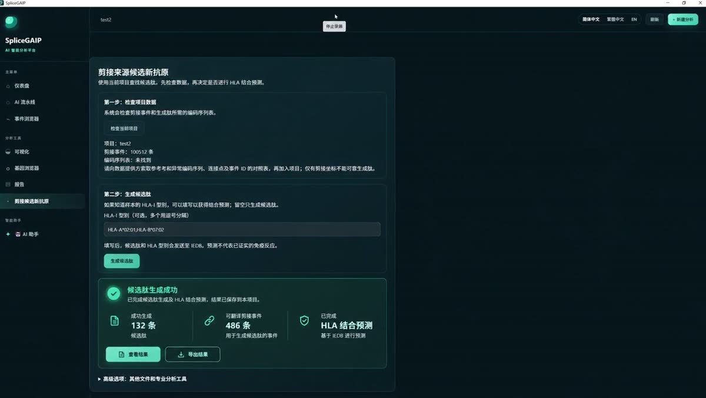
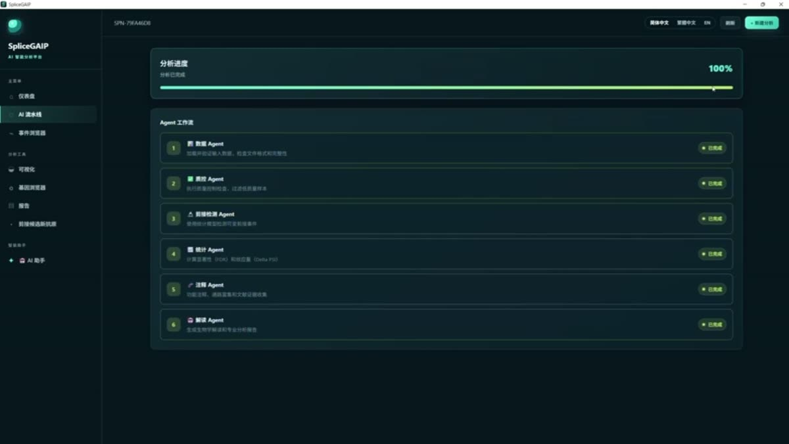

# 媒体素材 · Media Assets

本目录放 EpitopeRank 的**界面实录与配套字幕**。手册正文见 [`../docs/manual/`](../docs/manual)，
逐句讲解稿见 [`../docs/WALKTHROUGH.md`](../docs/WALKTHROUGH.md)。

This folder holds EpitopeRank's screen recordings and their subtitles. The manual lives in
[`../docs/manual/`](../docs/manual); the line-by-line narration script is in
[`../docs/WALKTHROUGH.md`](../docs/WALKTHROUGH.md).

---

## 1. 剪接来源候选新抗原 · Splice-derived neoantigen candidates

`1:00 · 1280×720 · 静音录屏 / silent capture`

事件 → 可翻译剪接事件 → 8–11 aa 跨连接点肽 → IEDB NetMHCpan 4.1 EL 结合预测 → 候选肽表。
本片记录了一个真实项目（test2，100,512 条事件，HLA-A*02:01 / B*07:02），产出 132 条候选肽。

| 文件 | 说明 |
|---|---|
| [`videos/splice-neoantigen-peptides.mp4`](videos/splice-neoantigen-peptides.mp4) | 原始录屏，无字幕 |
| [`videos/splice-neoantigen-peptides.bilingual.mp4`](videos/splice-neoantigen-peptides.bilingual.mp4) | 双轨软字幕（中文 / English，播放器内切换） |
| [`subtitles/splice-neoantigen-peptides.zh.srt`](subtitles/splice-neoantigen-peptides.zh.srt) | 中文字幕 |
| [`subtitles/splice-neoantigen-peptides.en.srt`](subtitles/splice-neoantigen-peptides.en.srt) | 英文字幕 |

---

## 2. 完整分析流程 · End-to-end pipeline

`1:47 · 3834×2160 · 静音录屏 / silent capture`

建项目 → 智能接入体检（90 事件 / 20 样本 / FDR 覆盖 100%）→ 人工确认分组 → 六 Agent
串行流水线（数据 / 质控 / 剪接检测 / 统计 / 注释 / 解读）→ 火山图与 PSI 热图。

| 文件 | 说明 |
|---|---|
| [`videos/pipeline-overview.mp4`](videos/pipeline-overview.mp4) | 原始录屏，无字幕 |
| [`videos/pipeline-overview.bilingual.mp4`](videos/pipeline-overview.bilingual.mp4) | 双轨软字幕（中文 / English，播放器内切换） |
| [`subtitles/pipeline-overview.zh.srt`](subtitles/pipeline-overview.zh.srt) | 中文字幕 |
| [`subtitles/pipeline-overview.en.srt`](subtitles/pipeline-overview.en.srt) | 英文字幕 |

---

## 播放说明 · Playback

- **带字幕的网页版**：[`docs/index.html`](../docs/index.html)（在线：<https://zhouhao-stak.github.io/EpitopeRank/docs/>），
  两段视频直接内嵌，右下角 `CC` 可切换中文 / English。网页字幕用 `.vtt`（`media/subtitles/*.vtt`），
  由同名 `.srt` 转换而来。
- GitHub 网页预览：点文件名可在线播放原始录屏，但不带字幕。
- 本地播放想看字幕：下载 `*.bilingual.mp4`，用 PotPlayer / VLC / IINA 打开，
  在「字幕」菜单里选 `中文 Chinese` 或 `English` 轨。
- 想要画面里直接带字幕的版本，见 [`docs/WALKTHROUGH.md`](../docs/WALKTHROUGH.md) 第三节的重编码命令。
